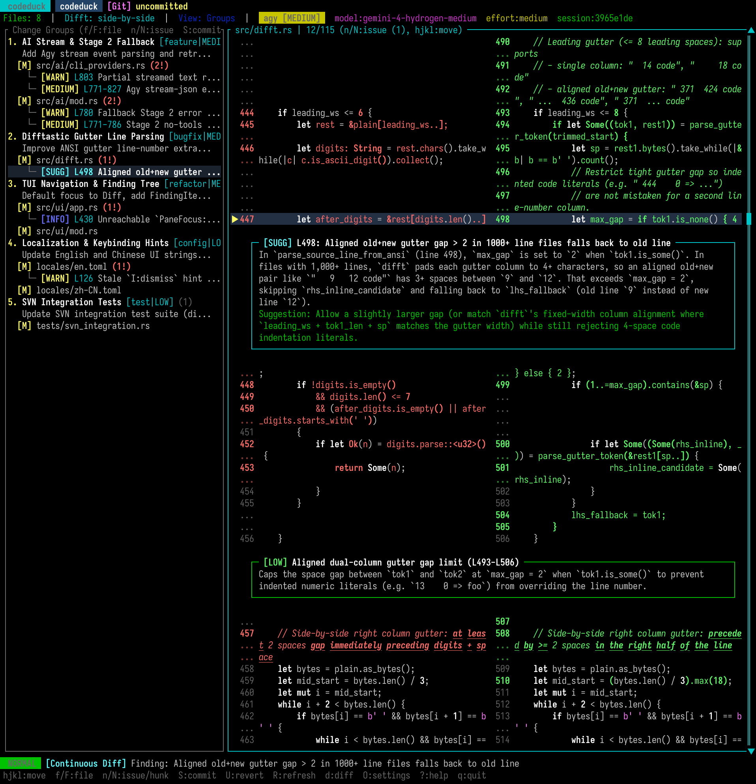
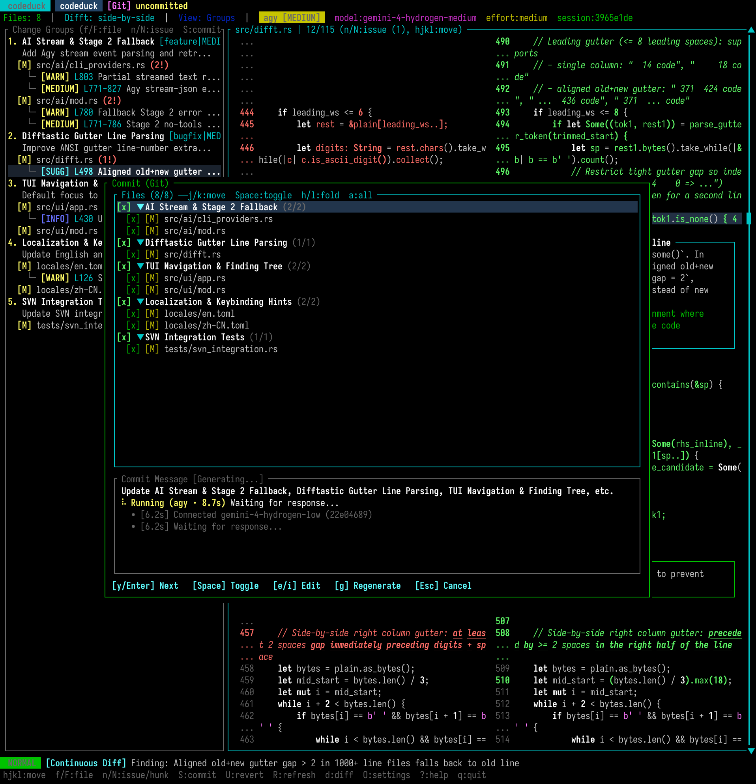

# codeduck

Vim-style terminal code review TUI powered by **Difftastic (`difft`)**, **Rust**, and local AI CLIs — built for **SVN** (including `svn:externals`) and **Git**.

## Screenshots

| Inline AI Review & Issue Tree | Grouped Commit & Live Message Generation |
| --- | --- |
|  |  |

## Features

- **Continuous Structural Diffs**: Side-by-side or inline diffs across all changed files via Difftastic.
- **Two-Stage Local AI Review**: Reuses existing local CLI subscriptions (`agy`, `codex`, `claude`, `gemini`, or custom CLIs in `~/.codeduck/configs.toml`) — no extra API keys needed:
  - **Stage 1**: Fast, stateless diff-only grouping and summary (`fast_model` / `fast_effort`).
  - **Stage 2**: Read-only core findings and hunk notes with reusable sessions in `~/.codeduck/sessions.toml`.
- **Commit & Revert Workflows**: Stage and commit by group/file with AI-generated English commit messages (`S`), or revert changes (`U`), both with double confirmation.
- **Ignore Rules & Export**: `.gitignore`-compatible `.codeduck` rules (`:ignore`), disk caching (`~/.codeduck/cache/`), and Markdown export (`e` / `--headless-export`).

## Prerequisites

- [`difft` (Difftastic)](https://difftastic.wilfred.me.uk/) in `$PATH`
- `svn` and/or `git`
- Optional local AI CLI: `agy`, `codex`, `claude`, or `gemini`

## Quick Start

```bash
cargo build --release

# Review uncommitted changes
cargo run --

# Review a revision/commit or range
cargo run -- -r 123
cargo run -- --range 100:120

# Override AI provider / models / session
cargo run -- --ai agy --model gemini-4-hydrogen-medium --fast-model gemini-4-hydrogen-low
cargo run -- --ai none

# Export Markdown report without launching TUI
cargo run -- -r 123 --headless-export review.md
```

## Keybindings

| Key | Action |
| --- | --- |
| `j` / `k` / `h` / `l` | Scroll continuous diff vertically / horizontally (`0` resets horizontal scroll) |
| `f` / `F` | Jump to next / previous file entry in the left outline (keeps focus in Diff) |
| `n` / `N` | Jump to next / previous AI issue once ready, otherwise next / previous diff hunk |
| `d` / `t` / `B` | Cycle Difftastic view mode / toggle AI-grouped vs. flat list / toggle sidebar |
| `S` / `U` | Commit / Revert selected group or file (double confirmation) |
| `a` / `P` / `A` | Re-run AI analysis / switch AI provider / ask AI about current file |
| `c` / `e` / `C` / `R` | Add note (`Esc` dismisses Q&A/note panel) / export Markdown / commit picker / force refresh |
| `O` / `/` / `:` / `?` | Settings & localization / search / command mode (`:rev`, `:wc`, `:ignore`, `:ai`, `:model`, `:fast-model`, `:revert`, `:q`) / help |

## Configuration

Precedence: `Defaults < ~/.codeduck/configs.toml < Project .codeduck < CLI flags` (override home dir via `CODEDUCK_HOME`).
For security, `diff.difft_bin` and `[[custom_ai]]` are only read from global `~/.codeduck/configs.toml`.

```toml
[ai]
provider = "agy"                      # auto | agy | codex | claude | gemini | none
model = "gemini-4-hydrogen-medium"
effort = "medium"                     # low | medium | high | xhigh | max
fast_model = "gemini-4-hydrogen-low"  # used for Stage 1 grouping & commit messages
fast_effort = "low"
language = "zh-CN"
reuse_session = true

[diff]
display_mode = "side-by-side"         # side-by-side | inline | side-by-side-show-both
cache_history = true

[ignore]
patterns = ["*.meta", "!keep.meta"]
```
